# Google ADK: Agents, Multi-Agent Systems & Framework Landscape

> Revision and interview notes from the CampusX course introduction video (Video 1 of the Google ADK playlist, ADK v2).
> Theory only: agents, multi-agent systems (MAS), why frameworks, what ADK is, where it fits, and the course roadmap.

---

## Table of Contents

1. [Course Context](#1-course-context)
2. [What is an AI Agent?](#2-what-is-an-ai-agent)
3. [Agent Architecture](#3-agent-architecture)
4. [Multi-Agent Systems (MAS)](#4-multi-agent-systems-mas)
5. [Benefits of MAS](#5-benefits-of-mas)
6. [Trade-offs of MAS](#6-trade-offs-of-mas)
7. [Common MAS Patterns](#7-common-mas-patterns)
8. [Why Use a Framework?](#8-why-use-a-framework-instead-of-vanilla-python)
9. [Framework Landscape](#9-framework-landscape)
10. [What is Google ADK?](#10-what-is-google-adk)
11. [ADK Origin & Release History](#11-adk-origin--release-history)
12. [The Google Ecosystem around ADK](#12-the-google-ecosystem-around-adk)
13. [Strengths of ADK](#13-strengths-of-adk)
14. [Limitations of ADK](#14-limitations-of-adk)
15. [Course Roadmap](#15-course-roadmap)
16. [Interview Q&A](#16-interview-qa)
17. [Revision Checklist](#17-revision-checklist)
18. [One-Page Cheat Sheet](#18-one-page-cheat-sheet)

---

## 1. Course Context

**Why this course exists:** agents are everywhere, and two frameworks dominate industry usage:

| Framework | Notes |
|---|---|
| **LangGraph** | Already covered on the channel. Lower-level control. |
| **Google ADK** | This course. More abstractions, tight Google ecosystem integration. |

**Two agendas of the course**

1. Teach ADK **from fundamentals** (using **ADK v2**, the most recent version; there were important changes between v1 and v2).
2. Teach how to build **multi-agent systems**. ADK's design natively supports them.

**Planned scope:** roughly 10-16 videos. Most are on YouTube, but notes are for CampusX members.

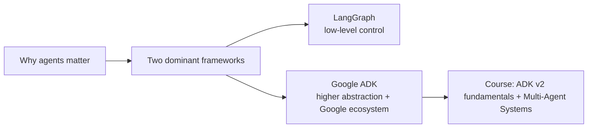

---

## 2. What is an AI Agent?

> **Definition:** An agent is what you get when you let a model **take actions in a loop toward a goal**. It decides what to do, **observes the result**, and decides again, until the goal is met or it gives up.

### LLM vs Agent

| Aspect | Plain LLM | Agent |
|---|---|---|
| I/O | Text in, text out | Text plus **actions** in the real world |
| Can take actions? | No (by definition) | Yes, via tools |
| Control flow | Single call | **Loop** that it controls |
| Goal | None (answers a prompt) | Has an explicit **goal** |
| Feedback | None | Observes outcomes and adjusts the plan |

### Three properties that make something an agent

| # | Property | Meaning |
|---|---|---|
| 1 | **Tool access** | Can search the web, call APIs, read/write files, run code. It changes the real world, not just prints words. |
| 2 | **Autonomy over control flow** | The agent itself decides the sequence of steps. |
| 3 | **Feedback loop** | Each action's outcome is observed, and the plan is adjusted. |

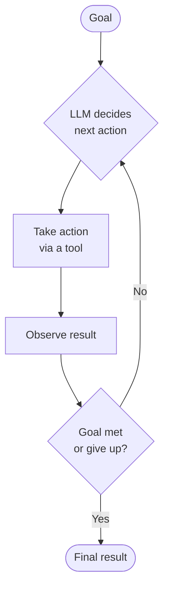

---

## 3. Agent Architecture

An agent has a **goal** plus three components, running inside the **agent loop**.

| Component | Analogy | Role |
|---|---|---|
| **LLM** | Brain | Reasoning and decision-making |
| **Tools** | Hands and legs | Perform actions (search, APIs, code, files) |
| **Memory** | Memory | Retains context and past information |
| **Agent loop** | The cycle | Repeats until the goal is complete |

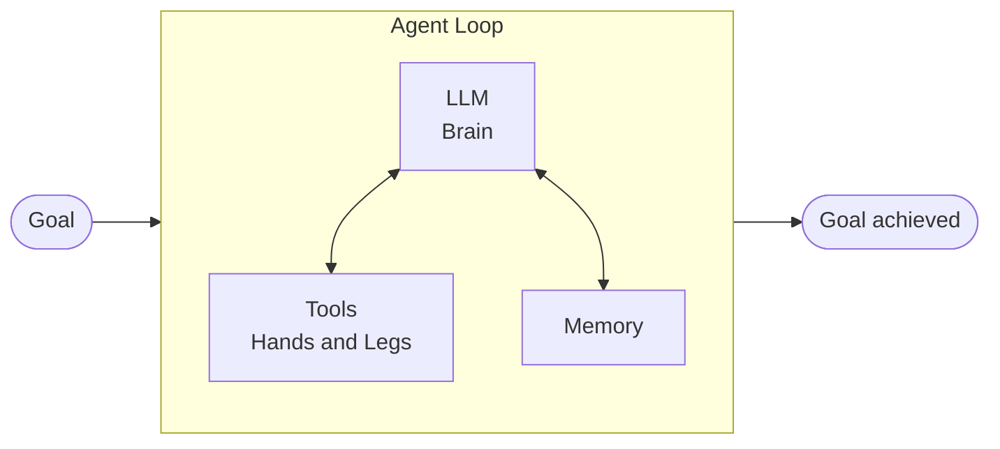

---

## 4. Multi-Agent Systems (MAS)

> **Definition:** A setup where **several AI agents work together** to accomplish a task. Each agent has its **own LLM, tools, memory and agent loop**, usually with a **narrower role**.

**Core philosophy:** instead of one agent doing everything, **split the work**.

### Example: Coding task

Coding is more than writing code: planning, architecture, writing, review and testing.

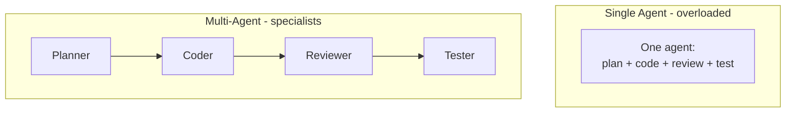

---

## 5. Benefits of MAS

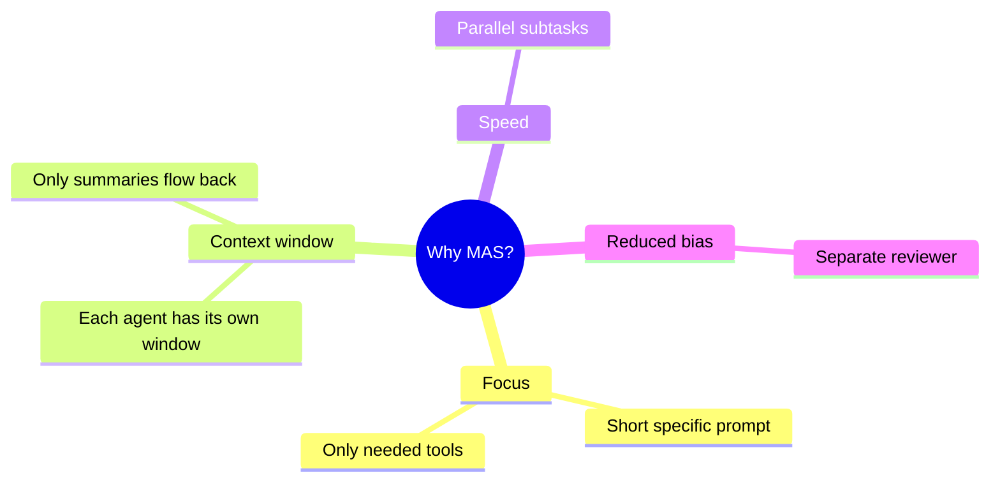

| # | Benefit | Explanation |
|---|---|---|
| 1 | **Focus** | Each agent gets a short, specific prompt and only the tools it needs, so it performs better (same as humans: small focused work beats everything at once). |
| 2 | **Context window management** | One agent doing everything fills its window fast and starts forgetting. In MAS each subagent uses its own window and returns only a **summary** to the parent, not all execution tokens. |
| 3 | **Speed** | Independent subtasks can run **in parallel** instead of sequentially. |
| 4 | **Less bias** | An agent that wrote the code is biased when reviewing it. A **separate reviewer** has not seen how the work was produced, so it judges more objectively. (Analogy: we can't criticise our own work well, which is why reviewers exist.) |

---

## 6. Trade-offs of MAS

MAS is **not always the answer**.

| # | Trade-off | Detail |
|---|---|---|
| 1 | **Complexity** | Agents are complex on their own. Multiple agents executing a hard task together is harder to design. |
| 2 | **Cost** | More agents mean more model calls and more tokens. Cost often runs away in **hidden** ways, and rises as soon as you move from single to multi-agent. |
| 3 | **Coordination problems** | The tech is still new. Agents may misunderstand each other, **repeat work**, or **miss important details**. |
| 4 | **Harder to debug** | It's a maze: who interacts with whom, when, and who is reading or changing state? Finding the root cause takes time. |

> **Rule of thumb:** use MAS when the task is genuinely complex, parallelisable, or needs independent review. Otherwise start with a single agent.

---

## 7. Common MAS Patterns

| Pattern | Idea | Typical example |
|---|---|---|
| **Orchestrator-Worker** | Lead agent splits the task, workers execute, the lead merges | Research blog, codebase understanding |
| **Sequential Pipeline** | Agents run one after another | Research, then Write, then Edit |
| **Parallel (Fan-out / Voting)** | Same input to multiple agents at once, outputs merged | Grading student answers on several criteria |
| **Debate / Critic (Proposer-Critic)** | One proposes, one critiques, loop until satisfied | Coder plus Reviewer |
| **Peer Collaboration** | Agents talk freely, no single boss | Simulated "village" of agents (experimental) |

### 7.1 Orchestrator-Worker

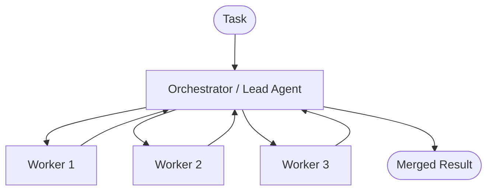

- **Research example:** the topic is split into 4 sub-topics, 4 workers research in parallel (web search, papers, YouTube), and the orchestrator merges them into a blog.
- **Codebase example:** workers explore the backend, frontend and database, and the orchestrator produces a summary.

### 7.2 Sequential Pipeline

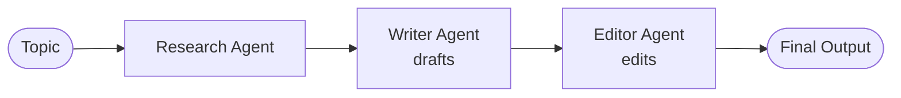

### 7.3 Parallel Execution with Voting / Merge

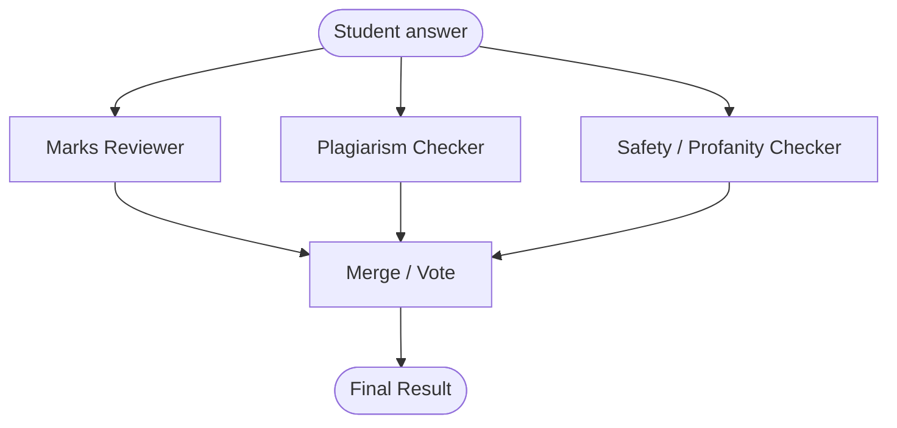

### 7.4 Debate / Critic (Proposer-Critic loop)

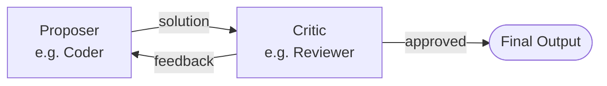

Loops until the critic is satisfied.

### 7.5 Peer Collaboration

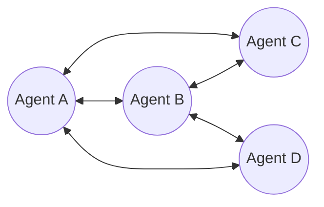

No single boss. It is less common in real-world use, and the course probably won't cover it.

---

## 8. Why Use a Framework Instead of Vanilla Python?

**Honest take from the course:** if you're experienced and the project is simple, writing vanilla Python is fine (and better for learning). Frameworks matter when the agent gets **complex**.

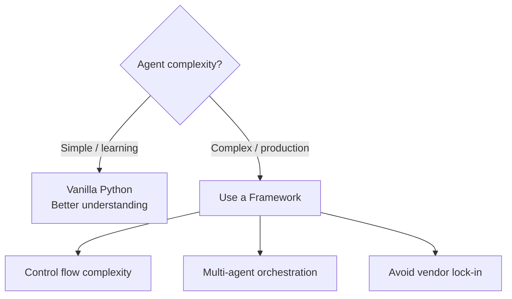

| # | Reason | Detail |
|---|---|---|
| 1 | **Control flow and plumbing code** | Real agents need multiple LLMs, model gateways, MCP tools, memory, **retries, timeouts, fallbacks, tool-failure handling**. This "glue code" is hectic and eats time. Frameworks give one-call retry and fallback. |
| 2 | **Multi-agent orchestration** | Routing work between agents, **handoffs**, passing **state**/progress, **parallel execution**, merging results. Hard to hand-write. |
| 3 | **Vendor lock-in (biggest reason)** | Using one provider's SDK (e.g. OpenAI's) ties you to its message format, tool-calling format, streaming, prompt caching, extended thinking, rate limits and retries. Switching to Anthropic later means a **huge rewrite**. Frameworks abstract this, so you become **model-agnostic**. |

---

## 9. Framework Landscape

| Framework | Backed by | Key strengths / notes |
|---|---|---|
| **LangGraph** | LangChain family | Python + JS. **Low-level control**, checkpointing, pause/resume, human-in-the-loop, long-running agents. Most mature. |
| **CrewAI** | Independent | Quickly build "crews" (multi-agent teams). Optimised for that workflow. |
| **Agno** | Independent | Very fast, lightweight, easy to learn, built-in memory. Quick basic agents. |
| **Pydantic AI** | Pydantic team | **Type-safe** agents, strong input/output validation. |
| **OpenAI Agents SDK** | OpenAI | Simple, easy to learn, good for simple and medium agents. |
| **Microsoft Agent Framework** | Microsoft | Successor to **AutoGen**. Enterprise-grade, strong **Azure** integration. Closest competitor to ADK (the instructor finds ADK more mature). |
| **Strands Agents** | AWS | AWS ecosystem. Less adoption in enterprise. |
| **Claude Agent SDK** | Anthropic | Uses the same agent loop as Claude Code. Less adoption so far. |
| **Google ADK** | Google | This course. |

**Instructor's verdict**

- **LangGraph** is the clear winner by adoption.
- If you are **not locked into a vendor**, choose between **LangGraph and Google ADK**.
- If you're already in Google's ecosystem, ADK is the natural choice. AWS users may pick Strands, and Azure users the Microsoft framework.

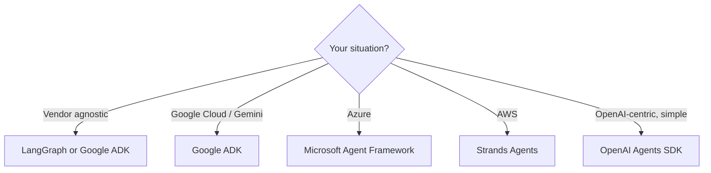

### LangGraph vs ADK (as described)

| Aspect | LangGraph | Google ADK |
|---|---|---|
| Abstraction level | Lower level, more control | More abstractions, easier to build |
| Multi-agent | Possible, more effort | **Designed for it by default** |
| Dev tooling | Need to write more yourself | Built-in web UI, traces, evals, deploy |
| Ecosystem | LangChain family | Google (Gemini, Vertex AI, A2A, Agent Engine) |
| Maturity | Most mature and widely adopted | Newer, backed by Google |

---

## 10. What is Google ADK?

> **ADK = Agent Development Kit.** An **open-source** framework from Google for **building, evaluating and deploying** AI agents and multi-agent systems.

Key clarifications:

- **Open source**, even though Google authored it.
- **Code-first toolkit**: you write code. It is *not* a visual or no-code builder, and not just writing prompts.
- You **orchestrate systems** in code to build agents and multi-agent systems.

---

## 11. ADK Origin & Release History

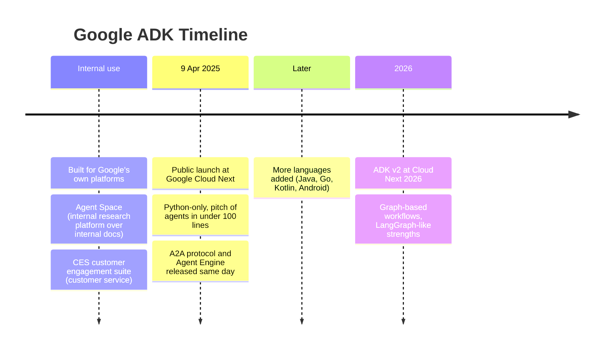

**Origin story:** ADK was **not built for the public**. It was built internally to **standardise agent building** for Agent Space and the CES customer engagement suite. Google later realised it was useful and **open-sourced** it.

**Why Google released it:** Google felt it was falling behind in the framework race. Microsoft had AutoGen and OpenAI had its SDK, while many smaller players were emerging. Google wanted an agent framework on top of **its own stack** for its customers.

**v1 to v2:** v2 lets you build agents in a **graph structure**, very similar to how you build in LangGraph. Google studied LangGraph and brought its strengths into ADK.

---

## 12. The Google Ecosystem around ADK

ADK is **part of a bigger ecosystem**, not a standalone tool.

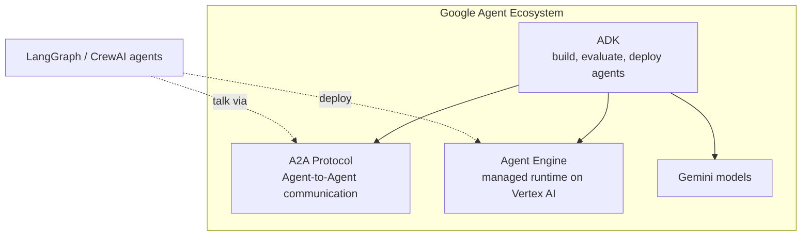

| Component | What it is |
|---|---|
| **ADK** | Open-source framework to build, evaluate and deploy agents. |
| **A2A (Agent2Agent)** | Open protocol for **agents to communicate across frameworks** (e.g. an ADK agent talking to a LangGraph agent). Launched day 1 with ~50 partners. Native support in ADK. |
| **Agent Engine** | **Managed runtime on Vertex AI** to deploy agents to production. **Framework-agnostic**: it can also deploy LangGraph, CrewAI and other agents. |
| **Gemini** | Google's models. ADK is most optimised for them, but works with others. |

---

## 13. Strengths of ADK

| # | Strength | Detail |
|---|---|---|
| 1 | **Built for multi-agent systems** | Designed from day one. Even your simplest app has the flexibility to add more than one agent. |
| 2 | **Model-agnostic** | Works best with Gemini but also runs OpenAI, Anthropic and other models (shown in the next video). |
| 3 | **Multi-language** | Python, TypeScript, **Java, Go, Kotlin, Android** (most libraries only offer Python/TS). |
| 4 | **Native A2A support** | Built-in functions, no extra code needed to communicate with agents from other frameworks. |
| 5 | **Great developer experience** | Out-of-the-box **web UI**, trace capture, run **evaluations** and **deploy** from there. In LangGraph you'd write much of this yourself. |
| 6 | **Built-in evaluation** | Evaluate each agent properly (dedicated video planned). |
| 7 | **Structured context** | Sessions, memory, tool outputs and artifacts are stored as **structured context**, not raw chat logs. This makes creating and retrieving them easy. |
| 8 | **Google backing** | Most trusted brand in tech, so it will be actively maintained with new features and versions. Strong choice for long-term solutions. |

---

## 14. Limitations of ADK

| # | Limitation | Detail |
|---|---|---|
| 1 | **Opinionated structure** | ADK enforces a **certain project organisation** and a **certain execution lifecycle**. Fine most of the time, but anything out of the box can feel restrictive. |
| 2 | **Ecosystem pull / lock-in** | Google nudges you toward **Gemini and GCP**. Optimisations are better for Google products, though other things still work. |

---

## 15. Course Roadmap

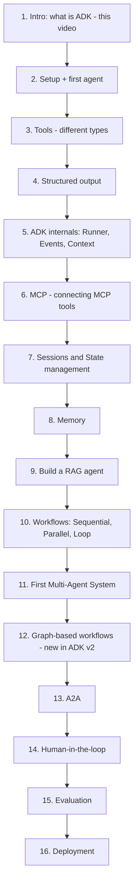

> Order and count (~15-16 videos) are tentative.

---

## 16. Interview Q&A

**Q1. What is an AI agent?**
A system that uses an LLM to take **actions via tools in a loop toward a goal**: it decides, acts, observes the result and repeats until the goal is met or it gives up. Three properties: tool access, autonomy over control flow, feedback loop.

**Q2. How is an agent different from a plain LLM?**
An LLM is a text-in/text-out system and cannot act. An agent adds tools, memory and a loop, so it can take real-world actions and adapt based on outcomes.

**Q3. What are the components of an agent?**
LLM (brain), Tools (hands/legs), Memory, and the Agent Loop, all pursuing a Goal.

**Q4. What is a multi-agent system? Why use one?**
Several agents, each with its own LLM, tools, memory and loop, cooperating on a task. Benefits: **focus, separate context windows, parallel speed, reduced bias** (independent reviewer).

**Q5. What are the downsides of multi-agent systems?**
Higher **complexity**, **cost** (more model calls and tokens), **coordination issues** (misunderstandings, repeated work, missed details), and harder **debugging**.

**Q6. How do subagents help with context window limits?**
Each subagent works in its own context window and returns only a **summary** to the parent, so the parent's window isn't flooded with execution tokens.

**Q7. Why is a separate reviewer agent better than self-review?**
An agent reviewing its own output is biased toward it. A separate agent hasn't seen how the work was produced, so it evaluates more objectively.

**Q8. Name the common multi-agent patterns.**
Orchestrator-Worker, Sequential Pipeline, Parallel (fan-out/voting), Debate/Critic (proposer-critic loop), Peer Collaboration.

**Q9. Explain the Orchestrator-Worker pattern with an example.**
A lead agent splits a task into subtasks, assigns them to workers (often in parallel), then merges results. Example: a research blog agent splits the topic into 4 sub-topics, workers research each, and the orchestrator merges into a blog.

**Q10. When would you use a Proposer-Critic loop?**
When output quality benefits from iterative refinement, e.g. a coder agent plus a reviewer agent that loops until the reviewer approves.

**Q11. Why use a framework instead of writing agents in vanilla Python?**
For complex agents: (1) control flow and plumbing (retries, timeouts, fallbacks, tools, memory); (2) multi-agent orchestration (handoffs, state, parallelism, merging); (3) **avoiding vendor lock-in** through provider abstraction. For simple projects and for learning, vanilla Python is fine.

**Q12. What is vendor lock-in in agent building?**
Building directly on one provider's SDK ties you to its message formats, tool calling, streaming, caching, rate limiting and retries. Switching providers needs a big refactor. Frameworks abstract this, making you **model-agnostic**.

**Q13. What is Google ADK?**
Agent Development Kit, Google's **open-source, code-first** framework for building, evaluating and deploying agents and multi-agent systems.

**Q14. What is the origin of ADK?**
Built **internally at Google** to standardise agent creation for Agent Space (internal research platform) and the CES customer engagement suite. Open-sourced later; launched publicly on **9 April 2025** at Google Cloud Next as a Python-only library.

**Q15. What launched alongside ADK?**
The **A2A protocol** (agent-to-agent communication, ~50 partners at launch) and **Agent Engine** (managed runtime on Vertex AI for production deployment).

**Q16. What is A2A?**
Agent2Agent, an open protocol that lets agents communicate in a standardised way, even across frameworks (e.g. ADK to LangGraph). ADK has native support.

**Q17. What is Agent Engine?**
A managed runtime on Vertex AI for deploying agents to production. It is framework-agnostic, so LangGraph and CrewAI agents can be deployed too.

**Q18. What changed in ADK v2?**
Support for building agents as **graph-structured workflows**, similar to LangGraph (announced at Google Cloud Next 2026).

**Q19. ADK vs LangGraph?**
LangGraph gives **lower-level control** and is the most mature and widely adopted. ADK offers **higher-level abstractions**, built-in multi-agent design, a dev web UI, evals and tight Google ecosystem integration. For vendor-agnostic teams the choice is typically between these two.

**Q20. Strengths of ADK?**
Built for multi-agent systems, model-agnostic, multi-language (Python/TS/Java/Go/Kotlin/Android), native A2A, strong dev experience (web UI, traces, evals, deploy), structured context (sessions/memory/artifacts), Google backing.

**Q21. Weaknesses of ADK?**
**Opinionated** project structure and lifecycle, plus ecosystem pull toward Gemini and GCP.

**Q22. Does ADK work only with Gemini?**
No. It is **optimised** for Gemini but works with any model (OpenAI, Anthropic, etc.).

**Q23. Is ADK a no-code or visual tool?**
No. It is **code-first**, and you write code to build and orchestrate agents.

**Q24. How do you pick a framework?**
If vendor-agnostic: LangGraph or ADK. Google ecosystem: ADK. Azure: Microsoft Agent Framework. AWS: Strands. Simple OpenAI-centric: OpenAI Agents SDK. Type safety: Pydantic AI. Fast crew-style teams: CrewAI.

---

## 17. Revision Checklist

**Agents**
- [ ] State the agent definition (actions in a loop toward a goal, observe, repeat)
- [ ] List the 3 properties: tools, autonomy, feedback loop
- [ ] Draw the architecture: LLM (brain), Tools (hands), Memory, Loop

**Multi-agent systems**
- [ ] Define MAS and explain the "split the work" philosophy
- [ ] Recall 4 benefits: focus, context window, speed, reduced bias
- [ ] Recall 4 trade-offs: complexity, cost, coordination, debugging
- [ ] Explain all 5 patterns with an example each
- [ ] Draw Orchestrator-Worker and Proposer-Critic from memory

**Frameworks**
- [ ] Give 3 reasons for frameworks: plumbing, orchestration, lock-in
- [ ] Place LangGraph, CrewAI, Agno, Pydantic AI, OpenAI SDK, Microsoft Agent Framework, Strands, Claude Agent SDK
- [ ] Explain when to choose which

**Google ADK**
- [ ] Define ADK: open source, code-first, build/evaluate/deploy
- [ ] Origin: internal, Agent Space and CES; public on 9 Apr 2025
- [ ] Ecosystem: ADK + A2A + Agent Engine (+ Gemini/Vertex AI)
- [ ] v2: graph-based workflows
- [ ] 8 strengths and 2 limitations
- [ ] Course roadmap in order

---

## 18. One-Page Cheat Sheet

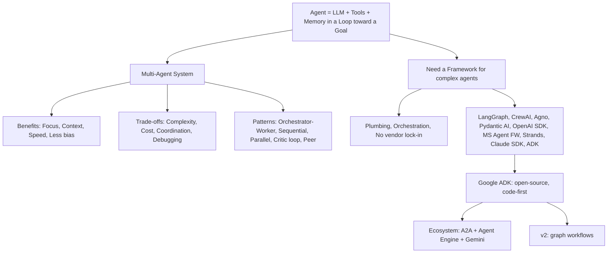

| Term | One-liner |
|---|---|
| Agent | LLM + tools + memory looping toward a goal |
| MAS | Multiple specialised agents collaborating |
| Orchestrator | Lead agent that splits and merges work |
| Handoff | One agent passing work and state to another |
| ADK | Google's open-source, code-first agent framework |
| A2A | Open agent-to-agent communication protocol |
| Agent Engine | Managed runtime on Vertex AI for deploying agents |
| Model-agnostic | Works with any LLM provider through abstraction |
